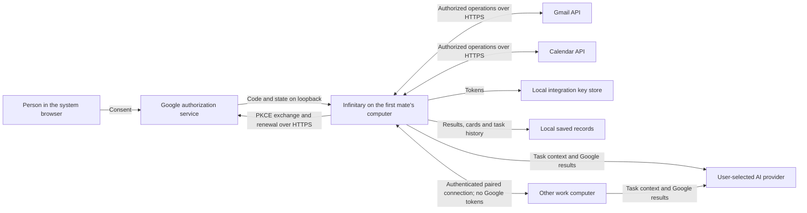

# Google verification material

This page owns the submission copy and evidence requirements for Infinitary's desktop Google integration.
It is an internal working draft, not a published privacy policy, a signed security declaration, or Google's approval.
The implementation is described in [Integrations](integrations.md#google).
Registration alone does not establish verification readiness.

## Readiness and ownership

The captain registers the Desktop app client in Google Cloud, accepts Google's terms, verifies the domain with their own sign-in, submits the verification, and engages an assessor if Google requires one.
The fleet prepares and checks the code, website copy, permission explanations, demonstration and technical answers.
The captain's registration is INF-903; client integration and this material are INF-887; verification submission is INF-904; assessment is INF-905.
No sample client belongs in `GOOGLE_OAUTH_CLIENT`.

| Requirement | What the submission must establish |
| --- | --- |
| Application identity | Actual project and Desktop app client, publisher's legal identity, support and privacy contacts, homepage and privacy policy on a verified domain, and the same app name everywhere. None is inferred from a project name. |
| Implemented permissions | Every requested permission has demonstrated functionality in the submitted build. Gmail and Calendar share the connection; permissions for future features are not a justification. |
| Consent and AI disclosure | Before Google access starts, the person sees and accepts how mail reaches the model providers, connected computers and saved task records. Google's consent screen alone does not explain these transfers. |
| Limited Use | Provider terms and account settings support the disclosed use, including no general-model training on Google data or its derivatives. A user's own subscription is not evidence of this. |
| Protection and deletion | Tokens and Google-derived records have adequate protection at rest and a demonstrated deletion route. File permissions are not encryption; disconnecting is not deleting transcripts. |
| Real demonstration | Infinitary's actual registered client, real consent screen and each requested permission's user-facing function appear in the verification video. A local stand-in is only rehearsal. |
| Assessment | Google or its assessor confirms the applicable scope and assurance level. Draft answers and passing product tests are not a letter of assessment. |

`GOOGLE_OAUTH_CLIENT` holds the registered Desktop app configuration for development and packaged builds on both channels.
The captain's private experimental rollout uses stable for private testers and alpha for personal development.
Packaged builds offer the existing Google connection but ignore development client and endpoint overrides.
The app does not infer verification or assessment from the build channel or Google's publishing status.
Public-launch readiness still needs the evidence and submissions above.

### Private experimental rollout

The intended Google Cloud configuration is **Google Auth Platform → Audience → External**, then **Publish app** to set **In production**, without submitting scope verification during this experimental phase.
The captain makes that account-side change; enabling the code does not publish the Cloud project or prove its current status.
Google's [audience documentation](https://support.google.com/cloud/answer/15549945?hl=en) distinguishes publishing from verification: an unverified production audience accepts accounts without a manually maintained tester list, subject to Google's controls.
Anyone reaching the authorization flow can attempt to connect; private distribution, not a Google invitation list, limits who receives the app.
Unapproved sensitive or restricted scopes still show Google's unverified-app warning and normally share a **100-user lifetime project cap**, not a concurrent-user allowance.
The cap cannot be reset, and Google may adjust quotas based on risk and history.
Managed accounts and other Google security restrictions can still block access.
New grants issued in production are not subject to the [seven-day refresh-token expiry specific to External / Testing](https://developers.google.com/identity/protocols/oauth2#expiration); changing status is not evidence that existing Testing grants gain a longer lifetime.
Revocation, Gmail password changes and other token-expiry conditions still apply.
If the project remains in Testing, only listed test users can connect and the seven-day rule still applies to these scopes.
Google's [restricted-scope guide](https://developers.google.com/identity/protocols/oauth2/production-readiness/restricted-scope-verification#exceptions) describes development/testing exceptions, not a blanket exemption for any product with fewer than 100 users.
An experimental rollout does not waive privacy, Limited Use, disclosure, downstream AI-processing or data-protection obligations, and does not claim CASA approval.
Use disposable Google data while the protection, deletion and provider-processing gaps below remain unresolved.

### Client handoff

After registration, ask once for the captain's chosen handoff of the downloaded **Desktop app** client file.
Prefer a file made available to this task, outside the working copy, over credentials pasted into a message, form or command line.
Do not assume a path on the captain's computer exists on a computer running the task.
Read only the supplied installed-client fields; reject a web client, service-account key, access token or refresh token.
Google calls desktop apps public clients that cannot keep a client secret confidential; the desktop client identity is not a user's Google sign-in.
Explain that the accepted design distributes this client configuration with the code, and never treat it as a confidential server credential.
Do not print the downloaded file or include it in reports, recordings or submission attachments.
Keep account tokens, passwords, verification codes and service-account keys out of the code entirely.
Remove any temporary copies the task creates after the intended fields are consumed; leave the captain's original file intact.

## Architecture and data inventory for reviewers

Infinitary is a desktop application, not a hosted mail service.
The computer running the first mate makes OAuth, Gmail and Calendar requests directly to Google.
Other paired computers can run agents that request those operations through the first mate's computer; the results, but not the Google tokens, can travel to those computers.
The chosen AI providers receive the task context and tool answers needed for the work.
Consequently, this is **not** a claim that Google data never leaves the user's computers or never reaches third-party servers.

| Data | Use and destination | Storage owner |
| --- | --- | --- |
| Google access and refresh tokens | Authorize API calls; renew and revoke access. Applied by the integration secret interface, not returned as tool output. | `FileIntegrationSecrets`, `userData/integrations/secrets/google/secrets.json`, a 0600 file in a 0700 directory. Plaintext JSON, not app-encrypted. INF-785 owns migration to secret management after INF-30. |
| Account address, scopes, expiry, sign-in health | Identify the row and maintain access. The address appears in Settings and agent context. | `GoogleSignInStore`, `userData/integrations/google.json`, 0600. |
| Message identifiers, thread identifiers, labels, headers and snippets | Search and triage mail; query results reach the requesting agent and its model provider. | Gmail holds the mailbox; returned results may persist in model sessions, task records and outputs. |
| Message text and attachment metadata | Read a selected message; HTML is converted to text. The read action reports attachment names, types and sizes, not an attachment-download feature. | Results can persist in sessions, reports, cards and user-requested files. |
| Recipients, subject and outgoing text | Prepare a draft or send after the person's approval of an exact action. | The pending write ask and task record keep its input; Gmail holds accepted drafts and sent messages. |
| Inbox history cursor and sender/subject summaries | Poll for new inbox messages while a rule listens; supply summaries to the rule's first mate turn. | Automation's saved cursor and task/session records. Lost history starts from now rather than replaying an old inbox. |
| Calendar lists, event data and availability | List calendars and events, read event details and busy intervals, create or update an event after approval, and react to changes in a selected calendar. Event data includes titles, descriptions, times, locations and attendees where Google returns them; a change notification carries title and times but not descriptions or guests. | Google holds the calendars; results can persist in task/session records, cards and outputs. Automation keeps a per-account, per-calendar sync token. |
| Diagnostic events | Fixed event names, booleans, numbers, app version and random installation identifier; no Google content or email address in permitted fields. | Sharing service and the configured diagnostics endpoint, as described in [Sharing](sharing.md). |

Removing Google calls revocation and deletes the local sign-in and keys even if Google cannot be reached.
A network failure is therefore not evidence that Google revoked the grant remotely; the person can also remove access in their Google Account.
Removal leaves task records, session transcripts, outputs and copies held by other services intact.
Task/session retention is durable, not seven days; the seven-day cleanup covers only a closed task's leftover evidence and scratch files ([Task retention](task-retention.md)).
The Settings data purge is broader than disconnecting and is not a per-Google deletion control.
Backups, exported files, another computer's saved copies and AI-provider retention require separate treatment.

## Permission justifications

Use the exact scope list in `GOOGLE_SCOPES` for the build being submitted.
Google's installed-app guide says incremental authorization is unsupported; it does **not** waive Google's rule against asking for permissions for unimplemented features.
The accepted single-row sign-in is demonstrated with Gmail and Calendar together before submission.

### Gmail: `https://www.googleapis.com/auth/gmail.modify`

**Draft submission text:** Infinitary helps the signed-in person find, read and organize their email, prepare replies, send messages they approve, and run a rule when a new inbox message arrives.
The person asks an AI assistant for this work and reads its answers in the application.
Search and message reads return mail to the assistant; labelling, archiving, drafting and sending each require the person's approval of the exact action on a card.
The integration uses message listing and retrieval, label listing and message modification, draft creation, message sending, the mailbox profile and mailbox history.
It does not expose permanent message deletion or mailbox settings management.

**Why narrower access does not provide these features:** `gmail.readonly` cannot label, archive, draft or send.
`gmail.send` cannot read or organize the inbox; `gmail.compose` does not provide general inbox reading and label modification.
`gmail.metadata` does not provide the full message text needed for reading and drafting a reply.
`gmail.labels` manages labels themselves, not applying and removing labels on messages.
For the person's mailbox, the message-modification endpoint accepts `gmail.modify` or the broader `mail.google.com` scope; the latter additionally permits permanent deletion and is not requested.
The endpoint also lists `gmail.modify.restricted` for administrators impersonating users through a service account with domain-wide delegation, not this desktop user's sign-in.
Do not justify this permission as necessary for sending alone.

**Evidence required:** Show a search, a message read, a label/archive, a saved draft, a send approved on its card and the resulting sent message, and a new-mail rule.
Use a disposable mailbox and only messages intended for demonstration.

### Calendar: `https://www.googleapis.com/auth/calendar.events`

**Draft submission text:** Infinitary lets the person list and read events and create or update an event in an existing calendar they can access.
Every modification requires their approval; the approved input also specifies guest notifications, which default to none.
It supports a calendar selected by its identifier, including a shared calendar subject to Google's access rules.
It also supports rules reacting to events created, changed or cancelled in a selected calendar.
No action deletes events, changes calendar sharing or creates calendars.
Read-only event or free/busy access cannot create or update events.
The owned-events scope excludes events on shared calendars where the person has editing rights.
The app-created-calendar scope excludes the person's existing calendars.
The full `calendar` permission also permits calendar and sharing management that this feature does not need.

### Calendar: `https://www.googleapis.com/auth/calendar.readonly`

**Draft submission text:** Infinitary lists the person's calendars so they can choose which calendar an action or rule uses, and reads busy intervals to answer availability questions without changing events.
The implementation calls `GET /users/me/calendarList` and `POST /freeBusy`; the read-only grant covers both without calendar-management permission.
Event read, create and update operations use the separate event permission above.

**Least-privilege review:** the [calendar-list endpoint](https://developers.google.com/workspace/calendar/api/v3/reference/calendarList/list) also accepts `calendar.calendarlist.readonly`.
The [free/busy endpoint](https://developers.google.com/workspace/calendar/api/v3/reference/freebusy/query) also accepts `calendar.events.freebusy` and `calendar.freebusy`, but does not list `calendar.events`.
A combination of calendar-list and availability grants may replace `calendar.readonly`; do not claim it is the only possible grant.
The one-row/all-permissions decision determines the sign-in experience, not an exemption from least privilege.
The registered client preserves the accepted three-scope set; a later scope change also updates the consent configuration and demonstration.

## Privacy policy draft

**Not in force; not for publication in this form.**
This is proposed Google-integration policy copy for legal and technical review, not a silent revision of `DATA-TERMS.md`.
The latter remains unpublished under [Sharing](sharing.md).
Replace the bracketed publisher details only with facts supplied by the owner and publish only after the readiness requirements above are met.
The policy must be publicly accessible on the verified homepage's domain and linked both from that homepage and the consent screen.

### Infinitary and your Google data

Publisher: **[legal publisher name and contact address]**.
Privacy contact: **[monitored privacy email]**.
Effective date: **[publication date]**.

Infinitary is an AI assistant that runs on your computers using the AI accounts you connect.
Connecting Google is optional.
Infinitary asks Google for permission to read, organize, draft and send email and for the Calendar permissions described in its consent screen.
You can also list calendars, read events and availability, and approve event creation or changes.
Infinitary does not offer an event-deletion action.
Infinitary does not receive your Google password.

### What Infinitary accesses and why

When you ask for help with email, Infinitary can retrieve message identifiers, senders, recipients, subjects, dates, labels, snippets, message text and attachment names, types and sizes.
It uses those results to answer your request, organize messages and prepare replies.
It shows a card for your approval before labelling or archiving a message, creating a draft or sending a message.
If you enable a new-mail rule, Infinitary checks Gmail's inbox history and gives the sender and subject of new messages to the assistant running your rule.
For Calendar tasks, Infinitary can retrieve calendar names and identifiers, access roles, time zones, event titles, descriptions, locations, start and end times, attendees and availability.
You approve event creation or updates, including the requested guest notifications.
A Calendar rule checks for changes in your selected calendar and sends event titles and times to the assistant; its notification summary excludes descriptions and guests.
The Google account address identifies your connection in the app.
Google sign-in tokens allow the app to keep working without asking you to sign in for each request.

### Where your information goes

Google receives requests for your Gmail and Calendar accounts and keeps accepted messages, drafts, mailbox changes and calendar changes in those services.
Infinitary runs those requests on the computer where your first mate lives.
Your other connected work computers can receive results needed for their tasks without receiving the Google sign-in tokens.
Your chosen AI providers receive the mail or calendar content and task context used to answer your request or carry out your rules.
This may include full message text when the assistant reads a message, not only its subject.
Infinitary is not an offline-only mail reader.
The app's publisher does not operate a server that relays your Google sign-in or mailbox contents.
If you ask the assistant to put information in a file or send it elsewhere, that output may create further copies or share it with your chosen recipients.

**Publication requirement:** identify the permitted AI-provider processing arrangements, retention and training terms, and the in-product consent for these transfers before replacing this paragraph with final copy.
Do not claim all user-selected subscriptions prohibit training or human review.
The disclosure must cover every recipient permitted for Google-derived data, including summaries and saved task context.

### Storage, retention and your controls

Infinitary stores Google sign-in tokens and connection details on the computer where the connection is made.
The current implementation protects token files using operating-system file permissions, not application-level encryption.
Mail used in a task can remain in the task's history, AI conversation, cards and files you asked to create.
Those records do not expire when you disconnect Google or finish a task.

In Settings → Integrations, you can pause Google or turn off individual actions to stop subsequent calls through those controls.
Removing Google deletes the local sign-in and tokens and asks Google to revoke access.
If the request cannot reach Google, also remove Infinitary's access from your [Google Account connections](https://myaccount.google.com/connections).
Disconnecting does not delete your Gmail messages, existing task history, output files, backups or copies already sent to AI providers.
The app's Settings data purge removes the local records it covers, not copies held elsewhere.
Contact **[privacy email]** for help identifying retained copies and the applicable deletion route; do not send your Google password or tokens.

**Publication requirement:** replace this requirement with verified instructions for deleting Google-derived data across supported computers, sessions, exports and providers.
Do not promise a targeted deletion feature, a retention deadline or encrypted storage until it exists and has been demonstrated.

### Other app data

Diagnostics, when enabled and disclosed, sends a fixed set of usage events, the app version and a random installation identifier to the configured diagnostics service.
Its permitted fields do not carry your Google address, message text, prompts, cards or file paths.
You can turn Diagnostics off in Settings → General → Sharing.
The contribution feature is unavailable in current builds; this policy does not authorize contributing Google data for training.

### Limited Use commitment for publication

**Publish the following commitment only when the application and every downstream processing arrangement can meet it:** Infinitary's use and transfer to any other app of information received from Google APIs will adhere to the [Google API Services User Data Policy](https://developers.google.com/terms/api-services-user-data-policy), including the Limited Use requirements, and the [Google Workspace user data and developer policy](https://developers.google.com/workspace/workspace-api-user-data-developer-policy).
Google data and information derived from it will not be sold, used for advertising or credit decisions, or used to train or improve generalized AI models.
Any permitted transfer will serve the disclosed user-facing feature with the user's consent or another exception Google explicitly permits.
Human access will be limited to the exceptions Google's policy permits, including the user's affirmative agreement to view specific data.

A future contribution or model-training feature needs its own review; redaction alone does not remove Google's restrictions on derived data.
A change to these practices requires updated disclosures and any new consent Google requires before the changed use starts.

## Demonstration script

The submission video must show the same registered application, the complete real OAuth grant in English, and functionality using every requested permission ([Google's video requirements](https://support.google.com/cloud/answer/13464321)).
A stand-in recording proves only the local UI and rehearsal flow; never submit it as Google's real consent page or evidence of verification.
Do not stitch a simulated consent screen into a real recording without a clear label.
The fleet operates the app and prepares the capture; the captain signs in and grants permissions personally.
Passwords, verification codes, client downloads, authorization codes and tokens must not enter the published video.
Use the task browser's handoff for captain-only input where supported; it deliberately does not expose or record that input for the crewmate.
If that privacy boundary prevents a complete real consent capture, arrange a captain-controlled recording of the consent segment rather than bypassing it.

### Recording environment

Use the hermetic launcher with a disposable home, disposable mailbox, a dedicated demonstration calendar and sample messages containing no real correspondence.
Use the actual registered Desktop app client only after the captain supplies it; a test client is never the production identity.
Use a disposable demonstration account that can authorize under the project's actual audience configuration; a project in Testing requires a listed test user.
Do not change the shared project's audience merely to record a demonstration.
Use the real APIs for the final capture and a model/account configuration whose Google-data handling has been checked.
The existing `startDemo` helper can capture local app segments; it does not capture the external browser.
An actual verification video may be longer than an Infinitary card demo; keep the submission deliverable separate from short review-card clips.

### Scenes and suggested narration

| Scene | Action and result to show | Narration |
| --- | --- | --- |
| Introduction and disclosure | Show Infinitary, the Google feature and the actual privacy/AI-transfer disclosure before connecting. | “Infinitary helps me read and organize email and manage my calendar. My chosen AI provider receives the information needed for this work.” |
| Grant | Open Settings → Integrations → Google. Show the actual app identity, policy link and complete Google consent page in English; the captain grants the requested scopes. Return to the signed-in row. | “One Google connection authorizes the permissions shown here. I can pause it, turn off actions or disconnect it.” |
| Search and read | Ask for the disposable message by a distinctive subject; show its sender, subject and text in the app's answer. | “I can find and read a message without copying it into a prompt.” |
| Organize | Ask to archive that message or apply an existing demo label. Show the approval card and then the change in Gmail. | “A mailbox change waits for my approval.” |
| Draft | Ask for a reply draft. Show approval and the draft saved in Gmail, with nothing sent. | “A draft remains a draft until I choose to send a message.” |
| Send | Ask for one harmless message to the same disposable account. Show recipients, subject and body on the approval card; approve once and show the resulting sent message. | “This card shows the exact message. Infinitary sends it only after I approve.” |
| Incoming mail | Enable a new-mail rule, deliver a new disposable message and show the assistant's response to its sender and subject. | “A rule can react to a new inbox message while Infinitary is running.” |
| Calendar | Show calendar discovery, event and availability reads, approved create/update operations and a change rule using only the demo calendar; disclose any guest notifications. No event-deletion action exists. | “The same connection supports these calendar actions. Changes wait for my approval.” |
| Controls | Pause the row and show a request refused; resume, then disconnect and show the row gone. Explain retained history without claiming it was deleted. | “Disconnecting removes the sign-in here. It does not erase earlier task records or copies already sent elsewhere.” |

Record each operation's actual outcome, not only the button press.
If a send's outcome is unknown, do not repeat it; inspect Gmail and resolve that uncertainty before making any claim in the video.
Review every frame for private data, stale app identity and readable permissions.
The final link must be accessible to Google's reviewer; uploading or submitting with the captain's account requires the corresponding permission, never an inferred approval from this script.

## CASA questionnaire answer bank

These are technical draft answers against the publicly linked [CASA specification](https://github.com/appdefensealliance/ASA-WG/blob/main/CASA/CASA%20Specification.md), not a completed assessor-issued form.
Use the assessor's actual questionnaire and version when received; obtain its decision on applicability and evidence, especially for a desktop app and its third-party AI processing.
“Partial” means a mechanism exists but the full control has not been established.
“Unproven” is not “Yes”; “proposed not applicable” is not an assessor's acceptance.
Do not invent an assurance level, penetration test, certification, scan result or incident procedure.

### General questions

| Question | Draft answer | Evidence or missing evidence |
| --- | --- | --- |
| What does the application do? | Desktop AI-assisted email and calendar productivity, with user-approved changes, new-mail rules and selected-calendar change rules. | `googleIntegration.ts`, `gmail.ts`, `calendar.ts`, `IntegrationsTab.tsx`; the final demo must cover the submitted build. |
| Where does restricted data travel? | Direct Google requests on the first mate's computer, results in local task/session stores and paired computers, and task context/results to selected AI providers. No publisher-operated Gmail proxy. | Data inventory above; downstream provider processing terms and model-request traces still required. |
| What is the authorization model? | Installed-app authorization code flow, S256 PKCE, random state and a loopback callback. Google passwords stay with Google. Changes/sends are kept as exact single-use approval requests. | `signIn.ts`, `IntegrationsService.call/sendAsk`; attach real-consent evidence for the submitted application. |
| Is user data encrypted at rest? | Not by the current integration store. Tokens are plaintext in a file restricted to the OS account; transcript and output encryption is not established. Do not answer Yes based on file modes or assumed disk encryption. | `secrets.ts`, `store.ts`; INF-785 covers token-store migration, but does not by itself establish protection for every derived record. |
| Can users revoke and delete? | Disconnect removes the local Google facts and keys and attempts revocation. Historical content, provider copies and exports remain. Settings purge is broader and does not prove per-Google deletion across destinations. | `googleIntegration.ts` removal, `docs/task-retention.md`; end-to-end deletion evidence is still needed. |
| Does any AI provider train on the data? | Not established for all supported subscription/provider configurations. The code's routing and a user's subscription do not demonstrate a no-training agreement. | Review each allowed downstream arrangement, retention/human-access terms and the consent shown before a Google result is sent. |
| Are vulnerability management, incident response and owner MFA established? | The project has code review and automated checks, but no current assessment, organization-wide policy or owner-account setting is certified by this answer bank. | Owner/assessor evidence required; do not claim scans, staff training, response deadlines or Cloud Console MFA from code alone. |

### Control mapping

| CASA control | Answer and applicability | Code/document owner and remaining evidence |
| --- | --- | --- |
| 1.1.1–1.1.3: password authentication | Proposed not applicable to an Infinitary password service: none exists. Google authenticates its own accounts; OS sign-in protects the local account. This does not assess those systems or other providers. | `signIn.ts`, `docs/architecture.md`; assessor confirms boundary and provider evidence. |
| 1.2.1: default credentials | No default production Google account is configured. Packaged builds ignore development client overrides. Public client identity is not a user's token. | `client.ts`; inspect the actual release and confirm no test keys or accounts. |
| 1.3.1–1.3.4: out-of-band verifiers | Google owns account verification. Infinitary generates a fresh state and PKCE verifier and cancels its loopback listener; there is no explicit overall sign-in expiry timer in this flow. | `signIn.ts`; assessor determines applicability, and expiry/brute-force requirements need explicit proof rather than a blanket pass. |
| 2.1.1: credentials in URLs | Access and refresh tokens use headers/form bodies. The standard OAuth redirect carries a short-lived authorization code and state; these must not be logged or published. | `signIn.ts`, `googleIntegration.ts`; inspect real capture/logging without exposing token values. |
| 2.2.1: logout invalidation | Partial: local removal deletes tokens and attempts remote revocation. Offline removal cannot certify remote invalidation. | `googleIntegration.ts`; exercise real revocation and explain offline recovery. |
| 2.2.2: password-change sessions | Google owns the password; the app reacts when Google refuses renewal. It cannot assert immediate invalidation of every session on a Google password change. | `googleIntegration.ts`; obtain Google's behavior and assessor's applicability decision. |
| 2.2.3: stateless token expiry | Google issues access-token expiry; Infinitary does not mint its own Google access tokens. Refresh tokens remain until revoked or rejected. | `issuedFrom`, renewal; expiry and other session boundaries require assessment. |
| 2.3.1–2.3.2: cookie flags | The Google integration uses bearer tokens, not an app session cookie. The external browser's Google cookies are Google's, not Infinitary's. | `signIn.ts`; do not apply this exemption to task-browser sign-ins or a future website without reviewing them. |
| 2.3.3–2.3.4: session tokens | OAuth access/refresh tokens authorize the user; static desktop client configuration alone does not. Google's token integrity is Google's responsibility. Paired-device sessions are a separate surface. | `googleIntegration.ts`, `docs/connection.md`; assessor confirms the token and paired-device scope. |
| 2.4.1: sensitive actions | Partial: an authenticated Google request and one-use approval are required for changes/sends. The app trusts the local OS account and does not add a separate password challenge to each approval. | `IntegrationsService.call/sendAsk`; assess account/session requirements, including paired control. |
| 3.1.1–3.1.3: access control | Core checks paused/off state, validates input and keeps changes as asks before calling the binding. A captured ask is consumed before execution and checked again. | `service.ts`; same-account agents have shell access, so this is not a filesystem isolation claim. |
| 3.1.4: object access | Mail requests address Google's authenticated `users/me` mailbox; Calendar requests name the selected calendar under that user's grant. Google enforces mailbox ownership and calendar roles. | `googleIntegration.ts`, `gmail.ts`, `calendar.ts`; real cross-account and shared-calendar role evidence remains to collect. |
| 3.1.5: request forgery | OAuth callback validates method, path and random state; PKCE binds the code exchange. App frames use sandboxed interfaces and host-owned approval controls. | `signIn.ts`, `docs/live-prototype-security.md`; requires broader IPC/paired-device assessment, not only the OAuth test. |
| 3.1.6: directory browsing | The OAuth loopback serves only the callback response, not a directory. No public mailbox file server is part of this integration. | `signIn.ts`; assess other in-scope file-serving components separately. |
| 3.2.1–3.2.2: OAuth | Authorization code plus S256 PKCE, a fresh random state, and a fixed loopback redirect reused during exchange. No implicit or resource-owner-password flow. | `signIn.ts`; pair the protocol tests with real registered-client evidence for the submitted application. |
| 3.3.1: administrator MFA | No public Infinitary administrator login serves Gmail. Cloud, source-host and publication accounts are outside what the code can prove. | Owner supplies account configuration evidence; paired control also needs scope review. |
| 4.1.1–4.1.2: transport | Packaged Google endpoints are HTTPS with redirects refused for API/token calls. Callback is HTTP on 127.0.0.1, as Google's installed-app flow supports. Paired connections use pinned TLS. | `client.ts`, `signIn.ts`, `googleIntegration.ts`, `docs/connection.md`; test actual destinations and certificate rejection. |
| 4.1.3–4.1.4: cryptography | Node's cryptographic randomness and SHA-256 provide PKCE/state; no custom encryption is claimed. At-rest protection remains incomplete. | `signIn.ts`, `secrets.ts`; assess all in-scope cryptography and failure paths. |
| 5.1.1: parameter pollution | Requests build named parameters with `URLSearchParams`; input schemas reject unsupported action fields. No blanket duplicate-parameter audit is claimed. | `signIn.ts`, `gmail.ts`; adverse duplicate callback cases require assessment. |
| 5.1.2: redirects | Token/API requests refuse redirects; production destinations are fixed Google endpoints. | `client.ts`, `googleIntegration.ts`; assess the separate system-browser navigation and any other recipient. |
| 5.1.3–5.1.4: dynamic code/templates | Mail is converted to text, not executed by the mail reader. Cards intentionally support scripts in isolated frames; agents can run code for tasks. | `gmail.ts`, `docs/live-prototype-security.md`; do not claim there is no dynamic execution anywhere. |
| 5.1.5: server-side request forgery | The Google binding uses fixed roots and validated/encoded identifiers; it exposes no arbitrary URL action. Other integrations, browsers and agent shells have broader reach. | `gmail.ts`, `client.ts`, `docs/task-browser.md`; assess the complete Google-data processing boundary. |
| 5.1.6: XML/XPath injection | Proposed not applicable to the Gmail action parser: it consumes JSON and MIME text, not XML/XPath. | `gmail.ts`; confirm no additional in-scope XML consumer. |
| 5.1.7: script injection | HTML mail becomes text; React text is escaped, and authored card HTML is sandboxed rather than sanitized. Instructions treat external results as evidence, not commands. | `gmail.ts`, `IntegrationsTab.tsx`, `docs/live-prototype-security.md`; prompt-injection resistance is not proven by stripping markup. |
| 5.1.8: database injection | Mail actions do not form SQL. Persisted tasks, asks and rules use their shared storage owners. | `service.ts`, `docs/task-record.md`; review/test those storage paths, not a blanket Yes from the mail module. |
| 5.1.9–5.1.10: commands/file inclusion | Gmail actions do not spawn a shell or load files named in mail. Agents can independently use shells and files for the person's task. | `gmail.ts`, `docs/architecture.md`; assess the agent boundary and malicious mail influence. |
| 5.2.1: untrusted files | This mail action reports attachment metadata and does not offer downloading or executing attachments. Other app file-handling features remain in scope if Google data reaches them. | `gmail.ts`; assessor confirms coverage. |
| 6.1.1: component vulnerabilities | Unproven. A lockfile, automated tests and release checks are not a current vulnerability assessment. | `pnpm-lock.yaml`, `docs/testing.md`; obtain the assessor's required component inventory, scans and triage. |
| 6.2.1: production debug mode | Partial: packaged Google setup ignores stand-in endpoints and client overrides. This does not audit all production debugging or logging. | `client.ts`; inspect the actual packaged release. |
| 6.3.1: Origin-only authorization | The callback uses state/PKCE, not the Origin header; the core has separate IPC and paired-device authentication. | `signIn.ts`, `docs/connection.md`; verify each in-scope request path. |
| 6.4.1: subdomain takeover | Unproven: no verified homepage/domain inventory is supplied here. | Domain owner and hosting evidence required; check DNS and decommissioned services before publishing. |
| 6.5.1: secret logging | Partial: integration results redact kept token values and connection metadata excludes them. Message bodies can themselves contain sensitive information, and sessions keep tool results. | `secrets.ts`, `store.ts`, `service.ts`; assess logs and saved records with disposable credentials. |
| 6.6.1: clearing client storage | Tokens are not stored in renderer localStorage. Disconnect removes local token/facts files, not historical Google content in task/session stores. | `store.ts`, `docs/task-retention.md`; demonstrate deletion, including derived and remote copies, before claiming complete clearance. |
| 6.7.1: secret storage | Gap: OS permissions and brokered use are present, but tokens are plaintext and same-account processes can read them. | `secrets.ts`; INF-785/INF-30 own secret-manager work; assess encrypted record storage separately. |

The Workspace policy additionally requires protection against prompt injection and limits general-model training and permanent copies.
These obligations are not discharged by a CASA table or by telling an agent to regard mail as untrusted.
The assessor needs the actual data flow, provider contracts, consent, storage/deletion behavior and security evidence, not only this application's source files.

## Sources and maintenance

Recheck the current requirements and the submitted application's behavior before using this copy; a source's requirements are not evidence that Infinitary satisfies them.

- [Google API Services User Data Policy](https://developers.google.com/terms/api-services-user-data-policy): transparency, minimum permissions, Limited Use and security obligations.
- [Google Workspace user data and developer policy](https://developers.google.com/workspace/workspace-api-user-data-developer-policy): permitted Gmail productivity use, prominent consent, AI use restrictions, encryption and prompt-injection protection.
- [Verification requirements](https://support.google.com/cloud/answer/13464321): homepage, policy, domain, permission justifications and complete demonstration video.
- [Restricted scope verification](https://developers.google.com/identity/protocols/oauth2/production-readiness/restricted-scope-verification): third-party-server assessment boundary and periodic reassessment.
- [OAuth for desktop apps](https://developers.google.com/identity/protocols/oauth2/native-app): public desktop clients, PKCE, loopback redirects and lack of incremental authorization.
- [Gmail scopes](https://developers.google.com/workspace/gmail/api/auth/scopes) and [message modification](https://developers.google.com/workspace/gmail/api/reference/rest/v1/users.messages/modify): permission breadth and required authorization.
- [Calendar scopes](https://developers.google.com/workspace/calendar/api/auth): narrower calendar-list, calendar-property and event scopes.
- [CASA requirements](https://appdefensealliance.dev/casa/casa-requirements) and its linked [specification](https://github.com/appdefensealliance/ASA-WG/blob/main/CASA/CASA%20Specification.md): control definitions and assessment applicability.

The implementation owners are `src/core/integrations/providers/google/`, `src/core/integrations/service.ts`, `src/core/integrations/secrets.ts`, `src/renderer/src/settings/IntegrationsTab.tsx`, and the session, task-retention, pairing and sharing documents linked above.
Update this page when those owners change the submitted Google behavior.
Keep recordings, transcripts, scan reports and assessment correspondence in the task evidence or approved submission destination, not committed beside this guide.
