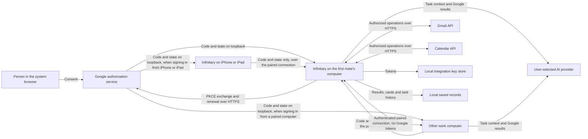

# Google: data flow and prompt injection

This page owns how Google's data moves through the app and what the app does against a message written to mislead an agent.
Each person signs in as their own Google client, so Infinitary submits nothing to Google for verification and holds no registered client; the privacy copy for Google lives on the website.
The implementation is described in [Integrations](integrations.md#google).

## Architecture and data inventory for reviewers

Infinitary is a desktop application, with an iPhone and iPad app that controls it, not a hosted mail service.
The computer running the first mate makes OAuth, Gmail and Calendar requests directly to Google.
Other paired computers can run agents that request those operations through the first mate's computer; the results, but not the Google tokens, can travel to those computers.
A person can start the sign-in from a paired computer, or from Infinitary on iPhone or iPad: Google's page opens in that computer's browser or the phone's in-app browser, and that computer or phone passes the one-time code and state back to the first mate's computer, which alone makes the PKCE exchange and keeps the tokens.
The chosen AI providers receive the task context and tool answers needed for the work.
Consequently, this is **not** a claim that Google data never leaves the user's computers or never reaches third-party servers.

| Data | Use and destination | Storage owner |
| --- | --- | --- |
| Google refresh token | Renew and revoke access. Applied only inside the protected Secrets owner to the renewal request sent to Google's token address, never returned to the integration or as tool output. | A hidden entry in Secrets ([Secrets](secrets.md#app-services)), sealed under a root key held in the macOS Keychain or the Linux Secret Service; each renewal is approved on Secrets' card, once with Always allow. A file an earlier version kept is moved in and removed. |
| Google access token | Authorize API calls; revoke on removal. | The app's memory only; renewed at each start and before it expires. |
| Account address, scopes, expiry, sign-in health | Identify the row and maintain access. The address appears in Settings and agent context. | `GoogleSignInStore`, `userData/integrations/google.json`, 0600. |
| Message identifiers, thread identifiers, labels, headers and snippets | Search and triage mail; query results reach the requesting agent and its model provider. | Gmail holds the mailbox; returned results persist in model sessions for 30 days, and in what agents write into task records and outputs. |
| Message text and attachment metadata | Read a selected message; HTML is converted to text. The read action reports attachment names, types, sizes and part numbers. | Results persist in sessions for 30 days, and in what agents write into reports, cards and user-requested files. |
| Attachment files | A crewmate saves one attachment the person approved into its task's hand-over folder (users.messages.attachments.get), to read or use it for the task. | The task's hand-over folder on the computer that runs it, 0600, until the task closes or 30 days pass, or Delete Gmail and Calendar content. Words an agent reads inside the file are not fenced and persist in its session past the 30 days. |
| Recipients, subject and outgoing text | Prepare a draft or send after the person's approval of an exact action. | The pending write ask and task record keep its input; Gmail holds accepted drafts and sent messages. |
| Inbox history cursor and sender/subject summaries | Poll for new inbox messages while a rule listens; supply summaries, fenced as data from outside, to the rule's first mate turn. | Automation's saved cursor and task/session records. Lost history starts from now rather than replaying an old inbox. |
| Calendar lists, event data and availability | List calendars and events, read event details and busy intervals, create or update an event after approval, and react to changes in a selected calendar. Event data includes titles, descriptions, times, locations and attendees where Google returns them; a change notification carries title and times but not descriptions or guests. | Google holds the calendars; results persist in sessions for 30 days, and in what agents write into task records, cards and outputs. Automation keeps a per-account, per-calendar sync token. |
| Diagnostic events | Fixed event names, booleans, numbers, app version and random installation identifier; no Google content or email address in permitted fields. | Sharing service and the configured diagnostics endpoint, as described in [Sharing](sharing.md). |

Removing Google calls revocation and deletes the local sign-in and keys even if Google cannot be reached.
A network failure is therefore not evidence that Google revoked the grant remotely; the person can also remove access in their Google Account.
Removal leaves task records, session transcripts, outputs and copies held by other services intact.
What an agent read from Gmail or Calendar stays in its saved conversation for 30 days after it was read, then a note takes its place ([Task retention](task-retention.md#words-from-outside)).
Delete Gmail and Calendar content, in Settings → Integrations under Data, does the same at once for everything read so far, on this computer and on the computers that run its work, and the conversations themselves stay.
What an agent wrote in its own words, such as a report, a card or a file, stays until the task is deleted; the Settings data purge deletes every saved task on this computer.
Backups, exported files and AI-provider retention require separate treatment.

## Prompt injection

Google's Workspace policy asks for "protecting against prompt injection techniques by either using Google Cloud Platform's Model Armor or other prompt injection protection".
Infinitary takes the second route, in three layers:

1. Data from outside is fenced.
   Every Gmail and Calendar answer, and every event summary, reaches the first mate or a crewmate between marks whose random value the writer could not know, with any copy of a mark in the words broken and a line before and after saying never to follow what is inside ([Integrations](integrations.md#data-from-outside)).
   A saved attachment's own content is the exception: the answer naming it is fenced, but words a crewmate reads inside the file are not, and Google's notice says so.
2. Every action starts at Asks you.
   The host shows the exact call and agent’s reason, with Only this time highlighted for changes and sends.
   Always allow also permits later calls of that action until revoked, the first mate's and every crewmate's alike ([Integrations](integrations.md#the-rules)).
3. The person is told before connecting.
   Google's notice says what the app does against a message written to mislead and the way out it cannot close (`INTEGRATION_NOTICES`, [Integrations](integrations.md#googles-notice)).

Model Armor is not used: it runs in a Google Cloud project with billing, so every message would pass either through a service Infinitary runs, which the app does not have for this: the one service of ours the person's work passes through is the phone push relay, which forwards only cards sealed for a paired phone and cannot read them (`docs/phone-push.md`); or through each person's own Cloud project.
A local classifier that judges whether words try to steer an agent is not used either: it would be the host's verdict on natural language, which the project's principles leave to the agent (`docs/principles.md`, "Put ambiguous judgments in agent instructions" and "Build the agent's reach, never its verdicts").
The fence makes a model less likely to follow words it read, but it cannot guarantee that a model never does, so only Google's review decides whether this protection is enough.

### Ways out without an ask

A model misled by a message could try to send what it read elsewhere.
Each way out, and how it stands:

| Way out | Who has it | An ask in the way | Status |
| --- | --- | --- | --- |
| A Gmail send or draft, or a Calendar creation or update that notifies guests | Both | Yes until Always allow: the exact call on a card | Closed at Asks you; deliberately open at Always allowed |
| A GitHub write through its integration, on any repository | Both | Yes until Always allow: the integration’s host card | Closed at Asks you; deliberately open at Always allowed |
| A change on an MCP server, any tool not marked read-only | Both | Yes until Always allow | Closed at Asks you; deliberately open at Always allowed |
| A read on an MCP server, whose input the server receives | Both | Yes until Always allow | Disclosed here: the captain adds each server, and one that fetches any address the agent names is a way out |
| The crewmate's shell: any program, network address, or `git push` to a remote it names | Crewmate | No: crewmate isolation stays social, a captain decision (`docs/architecture.md`, rev-5) | Disclosed in Google's notice |
| A write to the task's own project, which sends at once | Crewmate | No | Disclosed, as the shell |
| The task's browser opening a public address | Crewmate | No | Disclosed, as the shell |
| A crewmate's own web tools, such as a Claude crewmate's fetch and search | Crewmate | No | Disclosed, as the shell |
| A brief or a steer from the first mate to a crewmate | First mate | No; the brief is on the task's record | Disclosed: it hands the words to a crewmate, which has the ways above |
| A card to the captain | Both | The captain reads it | Not a way out: it reaches only the captain, and a card's frame has no network |

Closing the crewmate's ways needs either a crewmate whose network is limited once its task has read Google data, which would revisit the captain's decision that crewmate isolation stays social, or the captain’s confirmation of each Google read.
INF-950 asks for each action and lets the captain choose Always allow; that choice does not close the crewmate’s other ways out.
Google’s notice tells the person about that reach before they connect.
